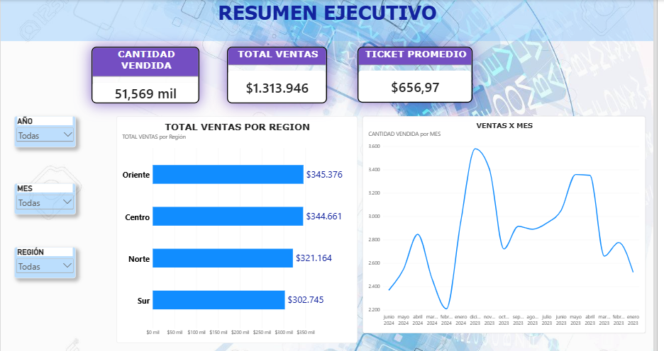
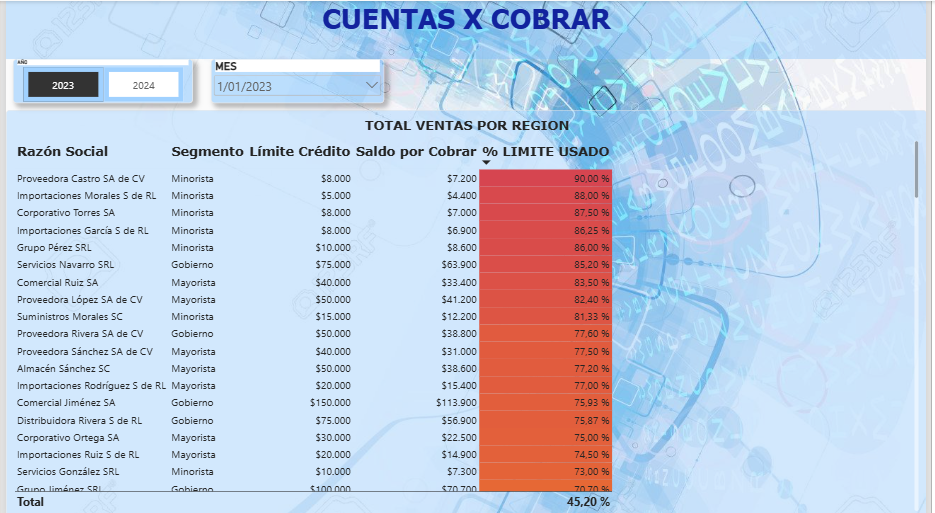

# 📊 Reporte Power BI - Tecnología e Innovación

## 📌 Descripción del Proyecto
Este proyecto consiste en un dashboard interactivo desarrollado en **Power BI Desktop**, diseñado para el análisis estratégico de métricas e indicadores clave (KPIs) en las áreas de tecnología e innovación.

El objetivo principal es facilitar la toma de decisiones basadas en datos mediante una visualización clara y dinámica de los rendimientos, adopción de tecnologías y gestión de recursos.

---

## 🖼️ Vista Previa del Dashboard

### Vista Principal

### Análisis Detallado

---

## 🛠️ Herramientas Utilizadas
* **Power BI Desktop:** Modelado de datos, creación de medidas DAX y diseño de visualizaciones interactivas.
* **Fuentes de datos:** [Menciona aquí la fuente de datos, ej. Archivo Excel / Base de datos SQL / CSV].
* **DAX (Data Analysis Expressions):** Cálculo de KPIs, métricas acumuladas y porcentajes de variación.

---

## 📈 Funcionalidades Clave
* **Control de KPIs:** Seguimiento de metas y desviaciones en proyectos de tecnología.
* **Filtros interactivos:** Segmentación por período, categoría y estado de proyectos.
* **Navegación fluida:** Marcadores y botones de navegación integrados.

---

## 🚀 Cómo ver o ejecutar el proyecto
1. Descarga el archivo `.pbix` desde este repositorio (`dashboard-tecnologia-innovacion.pbix`).
2. Asegúrate de tener instalado **Microsoft Power BI Desktop** (versión más reciente recomendada).
3. Abre el archivo descargado para explorar las interacciones y el modelo de datos.

---

## 👤 Autor
* **Stiven Escobar** - [Perfil de GitHub](https://github.com/stiven-escobar)
